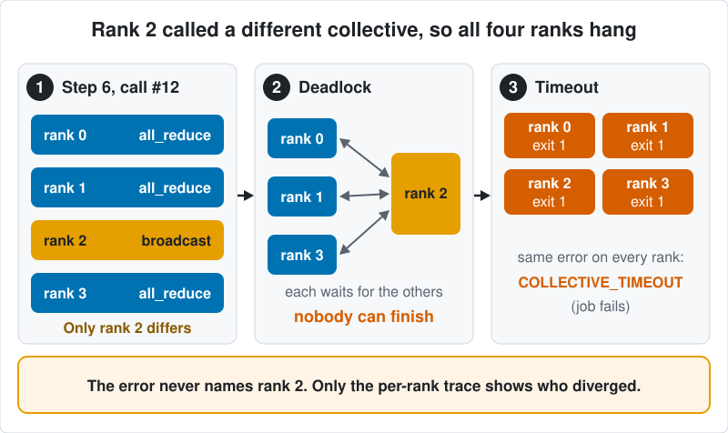

# TrainDoctor research

**Question.** When an agent repairs a failed distributed training job, a repair can make the job finish while silently breaking training (skipped or duplicated samples, wrong optimizer state). Does rewarding *verified* recovery, rather than only a correct diagnosis, teach a model to avoid such repairs?

**Verification mechanism.** The environment and verifier are in [traindoctor-env](https://github.com/TarangKhanna/traindoctor-env). Each candidate repair is re-executed in a network-less Modal (gVisor) sandbox; a verifier outside the sandbox checks launcher-recorded sample delivery, launcher-captured checkpoint history, and committed optimizer state against an uninterrupted reference or an independent replay of the update rule. The workloads are small synthetic CPU/Gloo jobs (four fault kinds in two families plus a healthy control), not production FSDP/NCCL training.

**Strongest measured findings** (all exploratory):

- Verifier on an author-designed development suite (menu v3, 720 Modal-sandboxed candidate outcomes): verifier v1.2 accepted 175/175 legitimate repairs and 0/271 repairs that complete but violate training semantics; 274 candidates did not complete and 0 hit infrastructure errors. This is not independent external validation, and the semantic oracle shares launcher records with the verifier ([accounting](experiments/menu_v3_dev/ACCOUNTING.md)).
- Red team: 0 of 86 scripted fake repairs accepted, but 38 of the rejections were execution failures, not invariant catches ([table](evidence/results/REDTEAM_TABLE.md)).
- Training (historical v0.1, Qwen3-4B, six paired seeds): GRPO with the recovery-aware reward scored 10.36 points above diagnosis-only reward on a held-out set, but the gain was evidence grounding, not better repair selection (71.4% vs 71.5%), and continued SFT at similar compute was statistically indistinguishable ([details](#results-historical-v01)).
- Negative results: menu v3 was a NO-GO for RL; held-out splits used new seeds, not new failure mechanisms; existing coding agents solved the development tasks, so the tasks do not rank strong agents; the protocol's minimum meaningful difference (7.2 vs 20 points) was never reconciled ([erratum](docs/ERRATUM_mmd.md)).

**What can be rerun.** From this repository on CPU: the policy table, repair-choice counts, red-team recount, figures, README number checks and checksums. Historical only: GPU training and evaluation and the sandbox replays (code is here, not re-run after the split). Not available: the held-out seed list (only its sha256), cross-agent prompts and transcripts, mutation-pilot receipts and per-run development JSON. See [Recomputing the results](#recomputing-the-results) and the [evidence map](docs/EVIDENCE_MAP.md).

[Evidence map](docs/EVIDENCE_MAP.md) · [Test report](evidence/results/TEST_REPORT.md) · [Menu v3 report](experiments/menu_v3_dev/REPORT.md) · [Verifier audit](experiments/verifier_audit/VERIFIER_AUDIT.md) · [Limitations](#limitations) · [Erratum](docs/ERRATUM_mmd.md) · [Provenance](PROVENANCE.md) (split from the library at `6a8f565`, fresh history)



The figure shows the A1 kind (mismatched collectives). Raw results and checksums are in [`evidence/`](evidence/README.md).

## Install

Python 3.12 or 3.13. The research code imports the library (`traindoctor_env`, `jobs`), which is pinned by commit in `requirements.txt`. Run everything from the repository root.

```bash
python3 -m venv .venv && source .venv/bin/activate
pip install -r requirements.txt
pip install -r requirements-rl.txt   # only for rl/ (Apple Silicon, MLX)
export PYTHONPATH=. TD_KEY=$(python -c "import secrets;print(secrets.token_hex(16))")
python -m pytest -q   # tests/test_first_update.py skips without MLX and a Metal device
```

## Models and compute

The trained model is Qwen3-4B (4 billion parameters), adapted with LoRA. It was first trained with supervised fine-tuning (SFT) on reference answers, then with GRPO (group-relative policy optimization, a reinforcement-learning method). Training and evaluation ran on Modal cloud GPUs (A100 and L40S), not on a laptop: evaluation used GPU inference, and repairs on the held-out set were verified by replay in Modal Sandboxes. Claude Sonnet and Codex were not trained or fine-tuned; they appear only in [Coding-agent evaluation](#coding-agent-evaluation-claude-sonnet-and-codex).

Terms used below. V0 rewards a correct diagnosis label. V1 also requires cited evidence that supports it. V2 (the recovery-aware reward) additionally requires a repair that passes sandboxed re-execution. Repair-selection accuracy is how often the model picks the repair that recovers the job. The held-out evaluation set was reserved before evaluation; its scenarios come from the same generator and the same fault mechanisms as the training data, so it tests new seeds, not new failure mechanisms.

## Results (historical v0.1)

Training. After SFT, Qwen3-4B received GRPO with diagnosis-only (V0) or recovery-aware (V2) reward, six paired seeds each, then was scored once on a held-out evaluation set of 100 incidents. Full-task success requires correct diagnosis, supporting evidence and a repair that passes live sandbox replay (V2) on the four faulted task kinds.

| Policy | Success |
| --- | ---: |
| Base model | 5.0% |
| SFT | 17.2% |
| Continued SFT, similar compute | 29.7% |
| GRPO, diagnosis-only reward (mean of 6 seeds) | 23.0% |
| GRPO, recovery-aware reward (mean of 6 seeds) | 33.4% |

- Reward comparison: the recovery-aware arm gained 10.36 percentage points over the diagnosis-only arm (95% bootstrap interval +5.83 to +15.26; positive in all six seeds).
- Where the gain came from: evidence grounding, not better repair selection. Both arms chose the recovering repair at the same rate (71.4% vs 71.5%) and label accuracy did not change.
- Continued SFT: a single run with similar compute is not distinguishable from the recovery-aware arm (+3.7 points; interval −1.7 to +9.1), so the table does not show that the recovery-aware reward beats spending the same compute on more SFT.
- Development split: the same V2-minus-V0 comparison was +4.64 points (interval −0.69 to +9.98), inconclusive.
- Minimum meaningful difference: the frozen protocol states 7.2 points and its power-analysis amendment states 20. The 10.36-point gain is above the first and below the second, and the two were not reconciled ([ERRATUM_mmd.md](docs/ERRATUM_mmd.md)).
- How scores were produced: training used precomputed outcomes from a development container; held-out scores come from 369 live sandbox replays. Report: [evidence/results/TEST_REPORT.md](evidence/results/TEST_REPORT.md).


Attacking the verifier. None of 86 fake repairs (swallow the exception, exit 0, shrink the world, raise timeouts, forge logs) was accepted: 48 were rejected by a correctness invariant and 38 failed during execution, which shows those cheats do not run, not that an invariant covers them. The reference repair was accepted 5/5 and alternative valid repairs 9/10 (one false rejection, fixed in a prepared v1.1 verifier). One scripted cheat, `world_size: 1` on the rank-divergence task, completes the job but leaves 72 missing and 8 duplicated samples. The verifier and attacks share an author; there was no external review. See [REDTEAM_TABLE.md](evidence/results/REDTEAM_TABLE.md) and [the audit write-up](experiments/verifier_audit/VERIFIER_AUDIT.md).


## Menu v3 development result

NO-GO for RL on menu v3. The 720 Modal-sandboxed candidate outcomes comprise 60 reference repairs, 115 valid alternatives, 271 incorrect-but-completed repairs, 274 non-completions and 0 infrastructure errors. Verifier v1.2 accepts 175/175 valid and 0/271 incorrect-but-completed repairs; v1 has 12 false rejections. See [ACCOUNTING.md](experiments/menu_v3_dev/ACCOUNTING.md) and [REPORT.md](experiments/menu_v3_dev/REPORT.md).

| Policy | P(V1 != V2) | V1-pass/V2-fail (of V1-pass) | Avoid-list share of V1-pass/V2-fail |
| --- | --- | --- | --- |
| Codex CLI (gpt-6.1-sol, medium) | 0.0% (0/120) | 0/102 | Undefined (no failures) |
| Qwen3-4B continued SFT (`csft`) | 2.9% [1.2, 5.0] | 7/24 | 6/7 |
| Qwen3-4B GRPO-V0 (`g_v0`, seed 0) | 5.8% [2.5, 9.6] | 14/41 | 9/14 |
| Qwen3-4B GRPO-V2 (`g_v2`, seed 0) | 7.1% [2.9, 12.1] | 17/40 | 14/17 |

Intervals are 95% seed-clustered bootstrap. The avoid-list is learned leaving one seed out and contains four fixed items: `sync:align`, `ckpt:from_progress`, `ckpt:fresh_optimizer`, `exclude_rank`. Codex chose no completing-invalid repair with V1 credit; trained-model disagreement remains below the roughly 10% target and is mostly explained by those items. The expectation that RL would mostly teach item identities is an inference.

Limitations: one development seed range, one strong agent and three checkpoints from one training seed, trained on menu v1 and evaluated here without retraining. V1-pass denominators are small, and no held-out-item evaluation tested generalization. Incidents ran locally; candidate repairs ran in sandboxes; Codex saw only the prompt. The semantic oracle shares launcher records with the verifier. These outcomes do not revise the historical v0.1 results. Details: [report](experiments/menu_v3_dev/REPORT.md).

## Coding-agent evaluation (Claude Sonnet and Codex)

Existing coding agents, evaluated separately from the Qwen3-4B 23.0% and 33.4% results, both recovered all six development tasks. The stricter score also requires evidence records: Claude scored 5/6 because one answer omitted a record, and Codex scored 6/6. These easy tasks do not establish a model ranking. Per-task results are published; prompts and transcripts are not ([report](experiments/cross_agent_dev6/BENCHMARK_REPORT.md)).

In a separate mutation pilot, eight procedurally mutated tasks passed trusted re-execution validation, then Codex solved 24 of 24 attempts. Those tasks also failed to discriminate, so the pilot stopped (NO-GO) ([pilot](experiments/mutation_pilot/README.md)).

## Recomputing the results

The [evidence map](docs/EVIDENCE_MAP.md) links claims to sources and recount commands. `python scripts/analyze_test.py` and `scripts/audit_test_recount.py` rebuild the policy table and repair-choice counts; `scripts/make_figures.py` redraws the figures; `scripts/check_readme.py` checks README numbers. Run `shasum -a 256 -c SHA256SUMS` in `evidence/results/`, `experiments/cross_agent_dev6/` and `experiments/mutation_pilot/`, and `shasum -a 256 -c results/SHA256SUMS` from `experiments/menu_v3_dev/` (its paths are relative to that folder).

- Recompute here (class A): the policy table, repair-choice counts, red-team recount, figures, README numbers and checksums.
- Historical: GPU training and evaluation (`modal_train/`, `rl/`), sandbox replays and `scripts/redteam_suite.py` ran before the split and were not re-run after it. The `redteam_suite.py` import of `traindoctor_env.modal_backend` was checked against the pinned library; sandbox runs were not repeated. Modal image setup: [modal_train/README.md](modal_train/README.md).
- Cannot be regenerated: the held-out evaluation set (only the seed-list sha256 is published); cross-agent prompts, raw answers, outcomes and harness; mutation-pilot receipts; the gate experiment; per-run development JSON behind the six-seed development comparison. These are withheld or lost; see evidence map class C.

The held-out evaluation protocol is copied unmodified into `evidence/prereg/`; its sha256 is in [evidence/README.md](evidence/README.md). The freeze happened in a private repository that is not published, so neither the copy nor its hash establishes when the freeze happened, and this repository's commit dates are not evidence of preregistration.

## Limitations

- Two synthetic task families; splits differ by seed, not by failure mechanism.
- In the historical v0.1 experiment, each repair menu has one recovering option, so V1 and V2 agree on 97.7% of development rollouts (a development-split figure, not measured on the held-out set). The results do not show that recovery-based reward improves repair selection.
- Six paired seeds is enough to see whether the sign is stable, not enough for statistical power.
- A post-hoc audit on 120 new development seeds found that the process-status records in the Tier A bundle separate A2 from A1 perfectly but not A1_src from A1_cfg ([report](https://github.com/TarangKhanna/traindoctor-env/blob/main/results/status_audit/run1/REPORT.md)). The bundles were not changed, and the audit does not measure whether the trained models used that shortcut.
- Tier B is an interactive development environment, not a validated multi-turn RL benchmark; the training results are Tier A only.
- No claim about production NCCL/FSDP failures, arbitrary training programs, or difficulty for frontier agents.

Related documents: [evidence map](docs/EVIDENCE_MAP.md), [rerun example](docs/RERUN_EXAMPLE.md), [findings](docs/FINDINGS.md), [realism of the fault families](docs/REALISM.md), [related work](docs/RELATED_WORK.md). Apache-2.0 ([LICENSE](LICENSE), [NOTICE](NOTICE)); citation in [CITATION.cff](CITATION.cff); security reports in [SECURITY.md](SECURITY.md).
